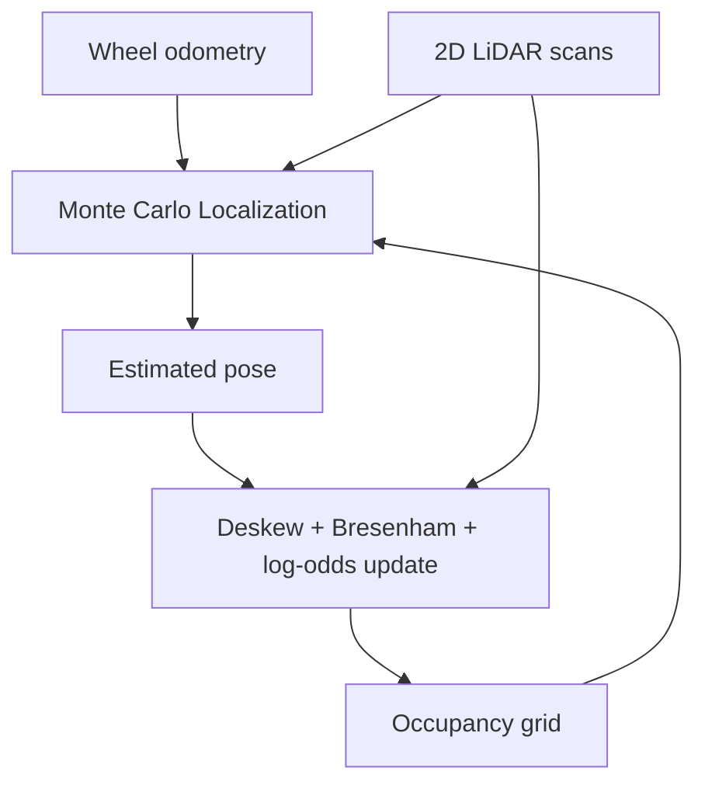

# Physical Mobile Robot Localization, Mapping & Navigation

> A recruiter-facing engineering portfolio for a physical ROS 2 autonomy stack developed in University of Michigan ROB 330.

- **Status:** Motion/odometry and SLAM checkpoints complete
- **Platform:** Differential-drive MBot, Raspberry Pi 5, RP2040/Pico, wheel encoders, IMU, 2D LiDAR
- **Software:** ROS 2 Jazzy, Ubuntu 24.04, C, C++, Python, RViz, Foxglove, rosbag

This project develops a bottom-up autonomy stack on a physical two-wheeled robot. It connects embedded wheel-speed control, encoder/IMU odometry, waypoint motion control, motion-compensated LiDAR mapping, Monte Carlo Localization (MCL), and simultaneous localization and mapping (SLAM).

## Engineering highlights

- Reduced physical wheel-speed tracking error to **0.0028 m/s MAE** with combined feedforward and PID control.
- Implemented and tested a C++ rotate-translate-rotate waypoint controller through **four consecutive physical square trajectories**.
- Built 5 cm-resolution occupancy maps from deskewed LiDAR scans and log-odds updates; Bresenham ray tracing averaged **4.04 ms per scan**, versus **6.67 ms** for divide-and-step.
- Evaluated MCL against a reference trajectory at **0.026 m position RMSE**, compared with **0.149 m for odometry alone** (about **83% lower error**).
- Profiled particle-filter execution on the Raspberry Pi from 100 to 1000 particles and selected **400 particles at about 64 ms/update**, preserving margin for a 10 Hz loop.
- Tuned real-robot motion uncertainty to reduce final SLAM heading correction from **11.2 degrees to 1.1 degrees**, eliminating a rotated duplicate of the maze.

## Localization result

The final MCL evaluation compares the estimated trajectory (blue), reference trajectory (green), and raw odometry (yellow). The particle-filter estimate follows the reference closely while correcting accumulated odometry drift.

## Physical SLAM result

The MBot autonomously drove the Checkpoint 1 maze out and back using the rotate-translate-rotate waypoint controller while the combined localization and mapping loop produced this occupancy map.

## Quantitative evaluation

| Evaluation | Result |
|---|---:|
| MCL position RMSE | **0.026 m** |
| Odometry-only position RMSE | 0.149 m |
| Selected particle count | **400** |
| Estimated update time at 400 particles | **~64 ms** |
| Projected 10 Hz limit | **~641 particles** |
| Bresenham map update | **4.04 ms/scan** |
| Divide-and-step map update | 6.67 ms/scan |
| Final heading correction after tuning | **1.1 degrees** |

## System architecture

## Project milestones

| Milestone | Engineering focus | Status |
|---|---|---|
| Motion and odometry | Motor calibration, wheel-speed control, encoder odometry, waypoint control | Complete |
| Mapping and localization | LiDAR deskewing, occupancy grids, particle-filter localization, SLAM | Complete |
| Planning and navigation | Global planning, obstacle costs, exploration, integrated navigation | Upcoming course milestone |
| Vision | Camera calibration and fiducial perception | Upcoming course milestone |

## My contributions

### Motion and control

- Ran physical feedforward, PID, and combined-controller experiments and compared their tracking performance.
- Tuned the selected wheel-speed controller through repeated physical tests.
- Implemented and tested the rotate-translate-rotate motion-controller state machine in C++.
- Repeated the square-driving experiment and adjusted effective differential-drive geometry to reduce systematic turning error.
- Collected rosbag data and used odometry and velocity topics to evaluate physical behavior.

### Mapping, localization, and SLAM

- Contributed to physical bring-up and testing of the team-integrated ROS 2 mapping and localization pipeline.
- Collected, replayed, and inspected real-robot data to evaluate occupancy-map alignment and localization behavior.
- Contributed to MCL/SLAM parameter evaluation, including particle-count timing, trajectory comparison, and action-model noise tuning.
- Documented the system architecture, test methodology, quantitative results, and physical-maze outcome.

Checkpoint 2 was developed with **Brandon McDonald, Samuel DeKoninck, and Natasha Sieh**. Team-level results are identified as such; this portfolio does not imply sole authorship of the full course stack.

## Engineering writeups

- [Controls and odometry](docs/controls-and-odometry.md)
- [Mapping and localization](docs/mapping-and-localization.md)
- [System architecture](docs/system-architecture.md)
- [Results and measurement notes](results/README.md)

## Academic-integrity notice

This repository is a **documentation-only engineering portfolio**. It intentionally excludes course starter code, completed assignment TODOs, private GitLab history, provided rosbags, submitted reports, and teammates' source code. It is not intended to distribute solutions to ROB 330 coursework.

The physical robot and starting software framework are provided through University of Michigan ROB 330. Results shown here come from Fall 2026 team experiments unless explicitly identified as individual work.
