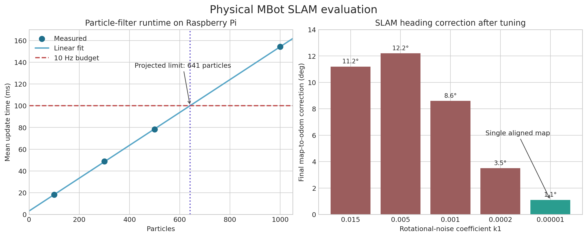
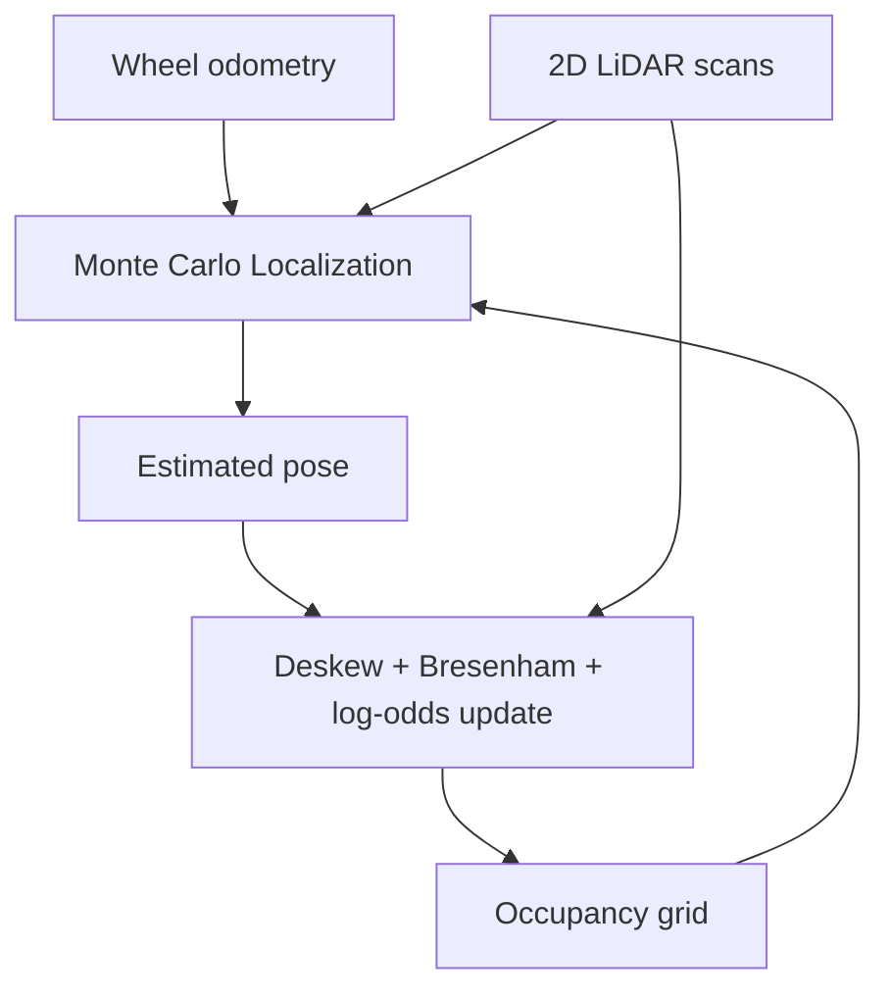

# Physical Mobile Robot Localization, Mapping & Navigation

> A recruiter-facing engineering portfolio for a physical ROS 2 autonomy stack developed in University of Michigan ROB 330.

- **Status:** Motion/odometry and SLAM checkpoints complete
- **Platform:** Differential-drive MBot, Raspberry Pi 5, RP2040/Pico, wheel encoders, IMU, 2D LiDAR
- **Software:** ROS 2 Jazzy, Ubuntu 24.04, C, C++, Python, RViz, Foxglove, rosbag

This project develops a bottom-up autonomy stack on a physical two-wheeled robot. It connects embedded wheel-speed control, encoder/IMU odometry, waypoint motion control, motion-compensated LiDAR mapping, Monte Carlo Localization (MCL), and simultaneous localization and mapping (SLAM).

## Engineering highlights

- Reduced physical wheel-speed tracking error to **0.0028 m/s MAE** with combined feedforward and PID control.
- Implemented and tested a C++ rotate-translate-rotate waypoint controller through **four consecutive physical square trajectories**.
- Built 5 cm-resolution occupancy maps from deskewed LiDAR scans and log-odds updates; Bresenham ray tracing averaged **4.04 ms per scan**, versus **6.67 ms** for divide-and-step.
- Evaluated MCL against a reference trajectory at **0.026 m position RMSE**, compared with **0.149 m for odometry alone** (about **83% lower error**).
- Profiled particle-filter execution on the Raspberry Pi from 100 to 1000 particles and selected **400 particles at about 64 ms/update**, preserving margin for a 10 Hz loop.
- Tuned real-robot motion uncertainty to reduce final SLAM heading correction from **11.2 degrees to 1.1 degrees**, eliminating a rotated duplicate of the maze.

## Localization result

The final MCL evaluation compares the estimated trajectory (blue), reference trajectory (green), and raw odometry (yellow). The particle-filter estimate follows the reference closely while correcting accumulated odometry drift.

## Physical SLAM result

The MBot autonomously drove the Checkpoint 1 maze out and back using the rotate-translate-rotate waypoint controller while the combined localization and mapping loop produced this occupancy map.

## Quantitative evaluation

| Evaluation | Result |
|---|---:|
| MCL position RMSE | **0.026 m** |
| Odometry-only position RMSE | 0.149 m |
| Selected particle count | **400** |
| Estimated update time at 400 particles | **~64 ms** |
| Projected 10 Hz limit | **~641 particles** |
| Bresenham map update | **4.04 ms/scan** |
| Divide-and-step map update | 6.67 ms/scan |
| Final heading correction after tuning | **1.1 degrees** |

## System architecture

## Project milestones

| Milestone | Engineering focus | Status |
|---|---|---|
| Motion and odometry | Motor calibration, wheel-speed control, encoder odometry, waypoint control | Complete |
| Mapping and localization | LiDAR deskewing, occupancy grids, particle-filter localization, SLAM | Complete |
| Planning and navigation | Global planning, obstacle costs, exploration, integrated navigation | Upcoming course milestone |
| Vision | Camera calibration and fiducial perception | Upcoming course milestone |

## Implementation and technical ownership

- Implemented and tuned embedded feedforward/PID wheel-speed control, encoder odometry, and a C++ rotate-translate-rotate waypoint controller for repeatable physical motion.
- Implemented motion-compensated LiDAR processing by interpolating robot poses across each scan, then constructed 5 cm-resolution occupancy grids with Bresenham ray tracing and bounded log-odds updates.
- Implemented the Monte Carlo Localization pipeline, including the probabilistic odometry action model, LiDAR endpoint sensor model, particle propagation, weight normalization, circular-mean pose estimation, and low-variance resampling.
- Integrated localization and mapping into an iterative SLAM loop that estimates pose, updates the occupancy grid, and publishes the map-to-odometry transform, particle cloud, and robot trajectory in ROS 2.
- Profiled particle-filter runtime on the Raspberry Pi, evaluated localization against a reference trajectory, and tuned motion uncertainty using real-robot bags to eliminate duplicated/rotated map geometry.
- Validated the complete autonomy stack on the physical MBot through controller experiments, autonomous waypoint runs, recorded-data replay, and an out-and-back maze-mapping demonstration.

This work was completed within a four-person ROB 330 project team. The implementation bullets above describe the end-to-end components I personally worked through and validated; the integrated checkpoint results were produced collaboratively.

## Engineering writeups

- [Controls and odometry](docs/controls-and-odometry.md)
- [Mapping and localization](docs/mapping-and-localization.md)
- [System architecture](docs/system-architecture.md)
- [Results and measurement notes](results/README.md)

## Academic-integrity notice

This repository is a **documentation-only engineering portfolio**. It intentionally excludes course starter code, completed assignment TODOs, private GitLab history, provided rosbags, submitted reports, and teammates' source code. It is not intended to distribute solutions to ROB 330 coursework.

The physical robot and starting software framework are provided through University of Michigan ROB 330. Results shown here come from Fall 2026 team experiments unless explicitly identified as individual work.
