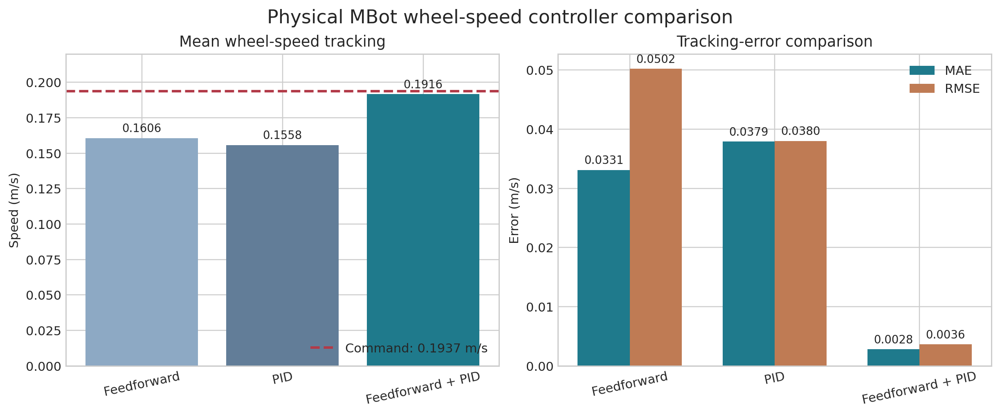

# Physical Mobile Robot Localization, Mapping & Navigation

> A recruiter-facing engineering portfolio for a physical ROS 2 mobile robot developed in University of Michigan ROB 330.

**Status:** Checkpoint 1 complete; Checkpoint 2 in progress  
**Platform:** Differential-drive MBot, Raspberry Pi 5, RP2040/Pico, wheel encoders, 2D LiDAR  
**Software:** ROS 2 Jazzy, Ubuntu 24.04, C, C++, Python, RViz, Foxglove, rosbag

This project develops a bottom-up autonomy stack on a physical two-wheeled robot. The work begins with motor calibration and embedded wheel-speed control, then connects odometry, waypoint motion control, LiDAR mapping, probabilistic localization, and SLAM.

## Current highlights

- Tuned and physically evaluated feedforward, PID, and combined feedforward-plus-PID wheel-speed controllers.
- Reduced mean absolute wheel-speed tracking error to **0.0028 m/s** in the recorded controller comparison.
- Implemented and tested a C++ rotate-translate-rotate waypoint controller on the physical MBot.
- Completed four consecutive square trajectories while recording odometry and velocity commands for evaluation.
- Generated and validated a **200 x 200-cell occupancy map at 0.05 m/cell** using physical LiDAR and odometry data.
- Currently developing the Monte Carlo localization portion of the stack, including particle resampling, state propagation, sensor likelihoods, and weighted pose estimation.

## System architecture

## Controller comparison

The same recorded test compared three wheel-speed control modes against a **0.1937 m/s** command.

| Controller | Mean measured speed (m/s) | MAE (m/s) | RMSE (m/s) |
|---|---:|---:|---:|
| Feedforward | 0.1606 | 0.0331 | 0.0502 |
| PID | 0.1558 | 0.0379 | 0.0380 |
| Feedforward + PID | **0.1916** | **0.0028** | **0.0036** |

In this run, the combined controller produced approximately **92% lower MAE than feedforward alone** and **93% lower MAE than PID alone**. The combined design uses the calibrated feedforward model for the nominal motor command while feedback corrects residual tracking error.

## Project milestones

| Milestone | Engineering focus | Status |
|---|---|---|
| Motion and odometry | Motor calibration, wheel-speed control, encoder odometry, waypoint control | Complete |
| Mapping and localization | LiDAR deskewing, occupancy grids, particle-filter localization, SLAM | In progress |
| Planning and navigation | Global planning, obstacle costs, exploration, integrated navigation | Planned course milestone |
| Vision | Camera calibration and fiducial perception | Planned course milestone |

## My contributions

### Motion and control

- Ran physical feedforward, PID, and combined-controller experiments and compared their tracking performance.
- Tuned the selected wheel-speed controller through repeated physical tests.
- Implemented and tested the rotate-translate-rotate motion-controller state machine in C++.
- Repeated the square-driving experiment and adjusted the effective differential-drive geometry to reduce systematic turning error.
- Collected rosbag data and used odometry and velocity topics to evaluate physical behavior.

### Mapping and localization

- Brought up and tested the ROS 2 mapping pipeline on the physical MBot.
- Generated and inspected a 10 m x 10 m occupancy grid with 0.05 m resolution.
- Currently working through Monte Carlo localization components and validating estimated motion against the provided reference trajectory.

The checkpoint system is developed in a team. This portfolio distinguishes my individual work from team-integrated results; it does not imply sole authorship of the full course stack.

## Engineering writeups

- [Controls and odometry](docs/controls-and-odometry.md)
- [Mapping and localization](docs/mapping-and-localization.md)
- [System architecture](docs/system-architecture.md)
- [Results and measurement notes](results/README.md)

## Media

Physical-run videos, trajectory plots, map images, and localization visualizations will be added after the related checkpoint artifacts are finalized and cleared for public portfolio use. See [the media checklist](media/README.md).

## Academic-integrity notice

This repository is a **documentation-only engineering portfolio**. It intentionally excludes course starter code, completed assignment TODOs, private GitLab history, provided rosbags, submitted reports, and teammates' source code. It is not intended to distribute solutions to ROB 330 coursework.

The physical robot and starting software framework are provided through University of Michigan ROB 330. All results described here come from project experiments in Fall 2026 unless otherwise noted.

