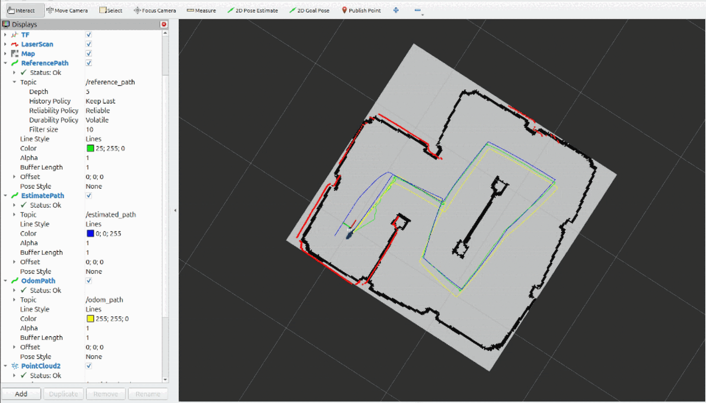
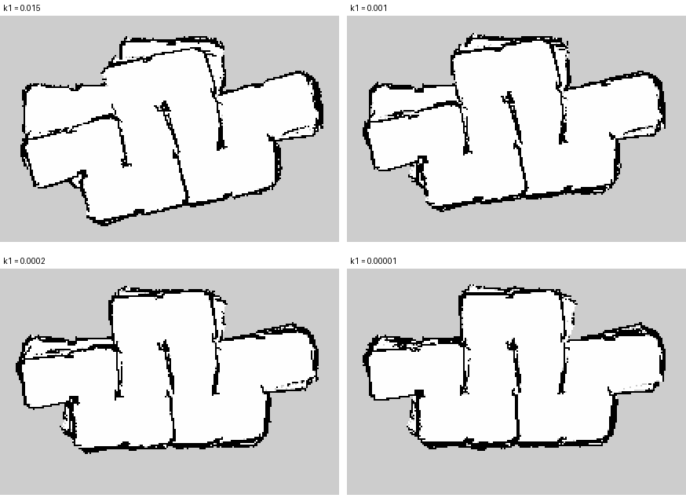
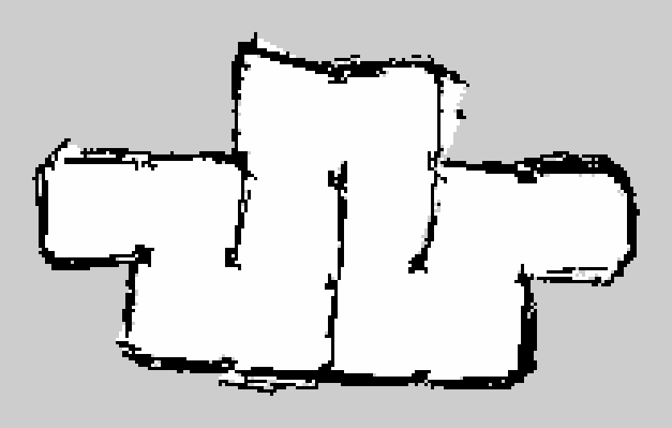

# Mapping, Localization, and SLAM

## Final Checkpoint 2 status

Checkpoint 2 is complete. The team-integrated system performs occupancy-grid mapping, Monte Carlo Localization (MCL), and simultaneous localization and mapping on the physical MBot using wheel/IMU odometry and 2D LiDAR.

The final maze run used:

- **Map resolution:** 0.05 m/cell
- **Particle count:** 400
- **Action-model parameters:** `k1 = 1e-5`, `k2 = 0.008`
- **Sensor-model ray stride:** 2
- **Log-odds increments:** hit `+0.85`, miss `-0.4`
- **Log-odds limits:** `[-4.5, 3.0]`

## Occupancy-grid mapping

The mapping pipeline associates each LiDAR beam with an interpolated pose to reduce motion distortion across a scan. It traces the beam through the grid, marks traversed cells as free, marks the endpoint as occupied, and accumulates bounded log-odds evidence.

Two ray-tracing implementations were evaluated across 1,050 scans:

| Ray tracing method | Mean map-update time | Observed result |
|---|---:|---|
| Divide-and-step | 6.67 ms/scan | Visually similar map, but thinner walls and more gaps |
| Bresenham | **4.04 ms/scan** | More solid walls and about 39% less processing time |

The team selected Bresenham because it updates discrete grid cells directly and produced cleaner walls with lower runtime.

## Monte Carlo Localization

The particle filter combines:

1. An odometry action model that decomposes motion into initial rotation, translation, and final rotation.
2. A LiDAR endpoint sensor model that scores how well each pose hypothesis agrees with occupied map cells.
3. Weight normalization and circular-mean heading estimation.
4. Low-variance resampling to preserve high-likelihood hypotheses efficiently.

On the provided maze evaluation bag, the selected configuration achieved **0.026 m position RMSE**, compared with **0.149 m for odometry alone**. The approximately **83% reduction** shows the value of correcting dead-reckoning drift with LiDAR/map agreement.

## Runtime scaling

Particle-filter update time was measured on the MBot Raspberry Pi:

| Particles | Mean update time | Updates measured |
|---:|---:|---:|
| 100 | 18.26 ms | 600 |
| 300 | 48.82 ms | 600 |
| 500 | 78.28 ms | 600 |
| 1000 | 154.37 ms | 400 |

Runtime grew approximately linearly at **0.15 ms per particle**. The projected 100 ms limit is about **641 particles**; the selected 400-particle configuration takes approximately **64 ms/update**, leaving margin for the rest of the 10 Hz SLAM loop.

## Real-robot SLAM debugging

The most important debugging result came from testing with a real out-and-back maze bag instead of relying only on the provided localization bag. With the robot's gyrodometry already maintaining an accurate heading, the original rotational-noise coefficient spread particles too far in yaw. The filter could settle on a locally plausible but rotated pose, causing the return pass to draw a second copy of the maze.

| Rotational-noise coefficient `k1` | Final map-to-odom heading correction | Map result |
|---:|---:|---|
| 0.015 | 11.2 degrees | Two rotated copies |
| 0.001 | 8.6 degrees | Two copies, smaller rotation |
| 0.0002 | 3.5 degrees | One end doubled |
| 0.00001 | **1.1 degrees** | **Single aligned maze** |

Reducing `k1` to `1e-5` lowered the modeled standard deviation for a 90-degree turn from about 8.8 degrees to 0.23 degrees. The final map stayed aligned while the sensor model continued correcting position.

## Final physical-maze result

The MBot drove the maze out and back autonomously using the Checkpoint 1 rotate-translate-rotate controller. The SLAM loop localized against the current map and then updated that map using the estimated pose.

## Contribution boundary

Checkpoint 2 was a team project with Brandon McDonald, Samuel DeKoninck, Natasha Sieh, and Anuj Arora. This portfolio presents team-integrated outcomes and Anuj's testing, tuning, evaluation, and documentation contributions without publishing course solution code or claiming sole implementation of the full stack.
