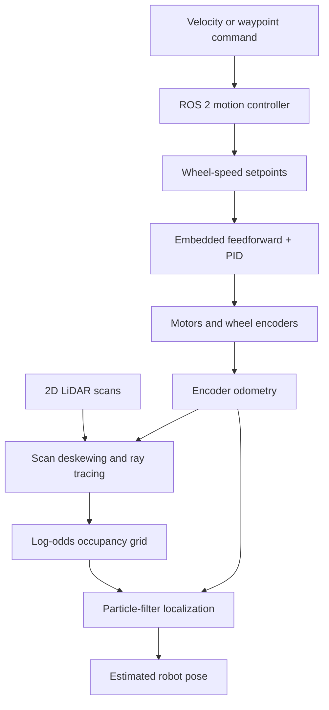

# System Architecture

## Hardware

| Component | Role |
|---|---|
| Differential-drive MBot | Physical mobile-robot platform |
| Raspberry Pi 5 | Runs Ubuntu 24.04 and the ROS 2 Jazzy application stack |
| RP2040/Pico control board | Executes low-level motor and encoder processing |
| Wheel encoders | Measure individual wheel motion for feedback control and dead reckoning |
| 2D scanning LiDAR | Supplies range measurements for occupancy mapping and localization |

## Software flow

## Current development boundary

The motion-control layer is complete for the current milestone. The mapping pipeline has been exercised on physical data and produced a saved occupancy map. Particle-filter localization and the combined SLAM loop are the current development focus.

This document intentionally describes interfaces and engineering decisions without reproducing course source code or assignment solutions.

