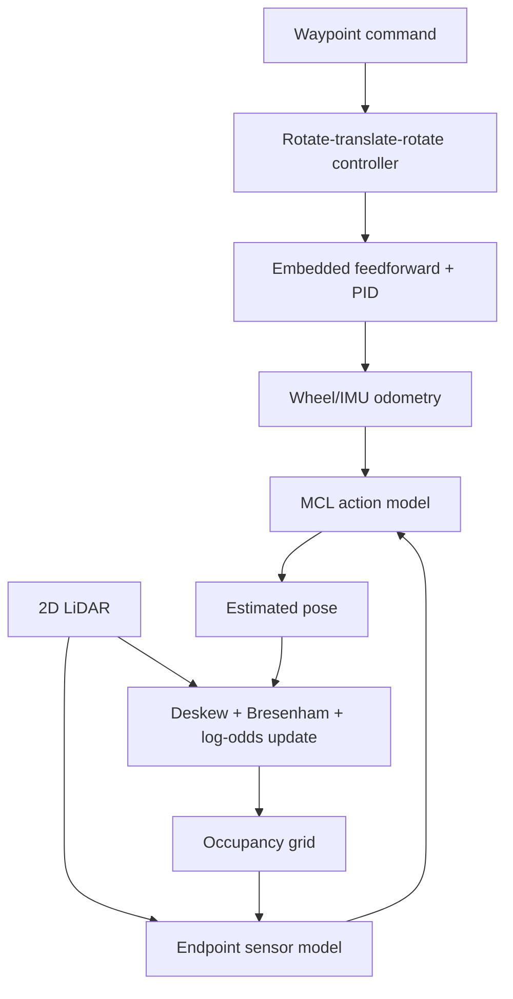

# System Architecture

## Hardware

| Component | Role |
|---|---|
| Differential-drive MBot | Physical mobile-robot platform |
| Raspberry Pi 5 | Runs Ubuntu 24.04 and the ROS 2 Jazzy application stack |
| RP2040/Pico control board | Executes low-level motor and encoder processing |
| Wheel encoders and IMU | Supply feedback control, dead reckoning, and gyrodometry |
| 2D scanning LiDAR | Supplies range measurements for occupancy mapping and localization |

## End-to-end autonomy flow

## SLAM update cycle

1. Compute incremental robot motion from wheel/IMU odometry.
2. Propagate the particle cloud through the probabilistic action model.
3. Score pose hypotheses against the current occupancy grid using LiDAR endpoints.
4. Normalize weights, compute the pose estimate, and perform low-variance resampling.
5. Deskew the new LiDAR scan using the estimated motion.
6. Ray trace through the map with Bresenham and update bounded log-odds values.
7. Publish the estimated pose, particle cloud, trajectory, occupancy grid, and map-to-odometry transform.

## Development boundary

The motion/odometry and mapping/localization milestones are complete. Planning, integrated navigation, and vision are later course milestones.

This document intentionally describes interfaces and engineering decisions without reproducing course source code or assignment solutions.
